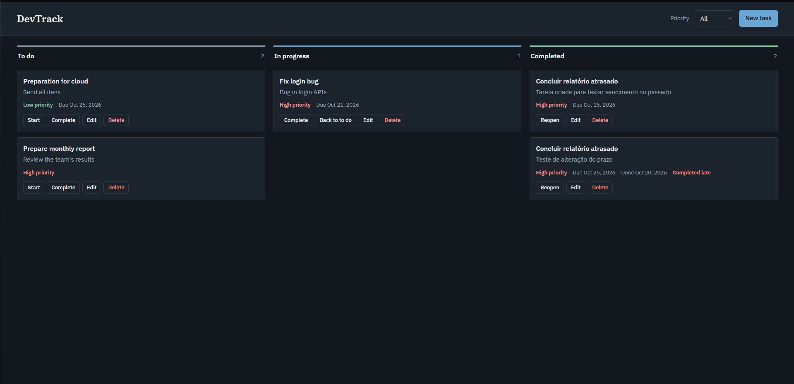
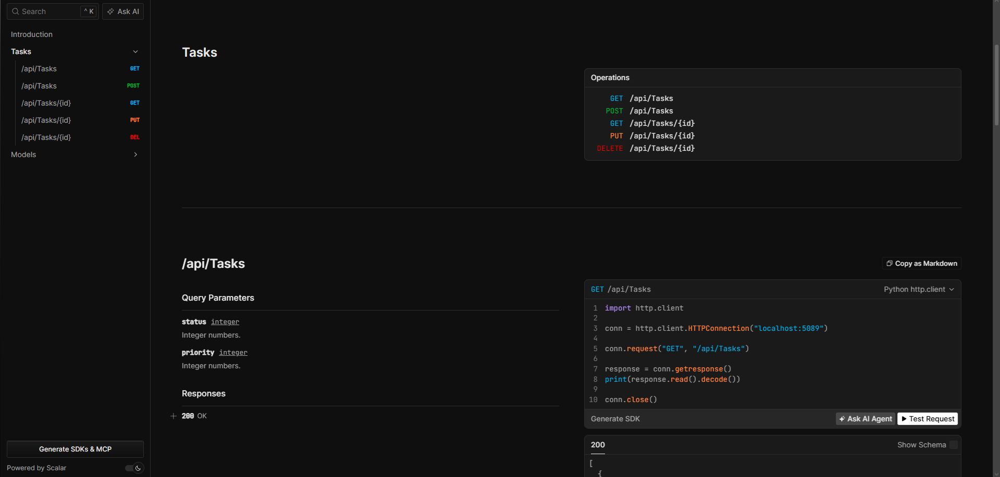

# DevTrack

A task management API for workplaces, built with C# and ASP.NET Core, with a lightweight web board to use it.



## Features

- Create tasks with a title, description, priority and due date.
- Retrieve a single task or a list, filtered by status and priority.
- Update task details and move tasks between **To do**, **In progress** and **Completed**.
- Soft delete: tasks are hidden but never removed from the database.
- Completion tracking: records when a task was completed and whether it was late.
- Validation with clear error messages (RFC 7807 problem details).
- Interactive API docs with Scalar.
- Built-in web board served by the API itself.

## Tech stack

- C# and .NET 10
- ASP.NET Core Web API
- Entity Framework Core with SQLite
- OpenAPI + Scalar
- Vanilla HTML, CSS and JavaScript (no build step)

## Getting started

### Prerequisites

- [.NET 10 SDK](https://dotnet.microsoft.com/download)

### Run

```bash
git clone https://github.com/Dr1zzty/DevTrack.git
cd DevTrack
dotnet restore
dotnet run
```

The database is created and migrated automatically in the Development environment.

Then open the address printed in the terminal (for example `http://localhost:5089`):

| URL | What it is |
| --- | --- |
| `/` | Task board (web interface) |
| `/scalar/v1` | Interactive API documentation |
| `/openapi/v1.json` | OpenAPI document |



## API

Base path: `/api/tasks`

| Method | Route | Description |
| --- | --- | --- |
| `GET` | `/api/tasks` | List tasks. Optional filters: `?status=` and `?priority=` |
| `GET` | `/api/tasks/{id}` | Get one task |
| `POST` | `/api/tasks` | Create a task (always starts as `ToDo`) |
| `PUT` | `/api/tasks/{id}` | Update a task, including its status |
| `DELETE` | `/api/tasks/{id}` | Soft delete a task |

**Priority:** `Low`, `Medium`, `High`
**Status:** `ToDo`, `InProgress`, `Completed`

### Example

Create a task:

```http
POST /api/tasks
Content-Type: application/json

{
  "title": "Fix login bug",
  "description": "Users are logged out after 5 minutes.",
  "priority": "High",
  "dueDate": "2026-10-30"
}
```

Response `201 Created`:

```json
{
  "id": 1,
  "title": "Fix login bug",
  "description": "Users are logged out after 5 minutes.",
  "priority": "High",
  "status": "ToDo",
  "dueDate": "2026-10-30T00:00:00",
  "createdAt": "2026-10-20T18:30:00Z",
  "completedAt": null,
  "wasCompletedLate": null
}
```

Validation error `400 Bad Request`:

```json
{
  "title": "One or more validation errors occurred.",
  "status": 400,
  "errors": {
    "Title": ["Title must be between 3 and 100 characters."]
  }
}
```

## Business rules

- A new task always starts as `ToDo`.
- Moving a task to `Completed` records `completedAt`.
- A task is completed late only if it is finished **after** its due date. Finishing on the due date itself counts as on time. Only the date is compared, not the time of day.
- Reopening a completed task clears `completedAt` and